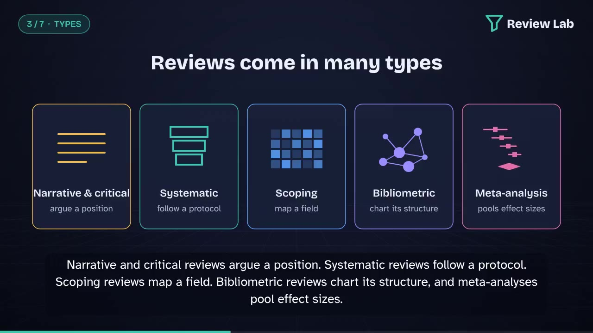

# Review Lab: Literature Reviews, Explained

**Review Lab** is an interactive learning platform and 3D digital twin for literature reviews, systematic reviews and meta-analysis. It is written for bachelor's, master's and PhD students and for researchers, and can be used for self-study or projected live in teaching.

**Live site:** https://rajan56.github.io/LiteratureReview-Explained/



## What is inside

| Section | What the learner does |
|---|---|
| Foundations | What a literature review is, why empirical articles, theses, dissertations and standalone review articles need one, and the five fundamental elements of reviews as independent studies (types, focuses, considerations, methods, contributions) after Kraus et al. (2022). |
| Learning paths | Four tabs (Bachelor's, Master's, PhD, Researchers) with expectations, fitting review types, typical scale and time, target synthesis mix, skills and common mistakes. |
| Atlas of 17 review types | Narrative, integrative, critical, state-of-the-art, semi-systematic, SLR, scoping, systematic map, bibliometric, meta-analysis, qualitative evidence synthesis, realist, framework-based, hybrid, umbrella, rapid and living reviews, each with SALSA profile (search, appraisal, synthesis, analysis), reporting standard, time, team and key sources; plus a side-by-side matrix. |
| Review finder | Six questions (aim, evidence, field size, time, team, output) and the learner's level are scored against every type, with reasons and cautions. |
| How each review is done | Step-by-step procedures for all 17 types, plus question frameworks (PICO, PICOC, SPIDER, SPICE, PCC). |
| **3D digital twin of a systematic review** | The review is modelled as a production line with eight modelled stations (search, deduplicate, title/abstract screening, retrieval, eligibility, appraisal, extraction, synthesis). Choose databases, synonyms, AND blocks, search field, filters, snowballing, screening strategy (single, checked, dual, AI-prioritised), agreement, team size and effort. The twin predicts records at every stage, estimated recall and precision, person-hours, calendar weeks and the bottleneck; draws a live PRISMA 2020 flow diagram and Gantt chart; generates an example Scopus query; and gives advice. Timeline mode replays the project week by week in 3D. All model assumptions are shown on the page. |
| Meta-analysis lab | Detailed explanation (when and when not to pool, effect sizes, common vs random effects, heterogeneity, publication bias, robustness, certainty), a calculator with editable data (real BCG trials plus illustrative datasets), forest and funnel plots, Egger's test, trim-and-fill, leave-one-out, prediction interval and plain-language interpretation; and a "what if" simulator for publication bias and heterogeneity. |
| Academic writing | Descriptive, analytical and evaluative synthesis: definitions, why each matters, signal phrases, the same topic written at three levels, recommended proportions by review type and by academic level with justifications, a model opening paragraph for the analysis section, and a Python synthesis analyser that labels each sentence. |
| Analysing secondary data | Extraction, deductive and inductive coding, concept matrix (interactive), thematic synthesis, bibliometric analysis with a 3D co-word science map, quality appraisal tools, and a Cohen's kappa screening-agreement tool. |
| Tools | Tools for every stage, from protocol registration to reporting, including AI-assisted screening and guidance on responsible use. |
| Python lab | An in-browser Python console running the same engine, with editable examples. |
| Video | A 90-second narrated video with burned-in captions, downloadable MP4 and MP3, WebVTT captions and timestamped script. |
| References | About 100 APA 7th edition references, each linked from in-text citations. |

## Architecture

```
Browser (GitHub Pages, static hosting)
├── index.html + src/*.js          UI, content model, controllers (ES modules, no build step)
├── src/twin-model.js              deterministic digital-twin model of the review process
├── src/twin3d.js, src/map3d.js     three.js scenes (production line, knowledge map)
├── src/py.js  ── Pyodide (CPython → WebAssembly, loaded from jsDelivr)
│                └── py/review_lab.py   Python engine: meta-analysis, bias tests,
│                                        simulation, kappa, synthesis analyser
└── tests/ + .github/workflows/     the engine is tested in CI on every push
```

Nothing is sent to a server: all computation, including Python, runs on the visitor's device.

### Validation

`py/review_lab.py` uses only the Python standard library. Its results for the BCG vaccine trials reproduce the reference values of R's metafor package (Viechtbauer, 2010): fixed effect −0.4303 (SE 0.0405); DerSimonian-Laird τ² = 0.3088; REML estimate −0.7145 (SE 0.1798), τ² = 0.3132, I² = 92.22%, Q(12) = 152.23. Run the tests with:

```bash
python tests/test_review_lab.py
```

## Run locally

```bash
git clone https://github.com/Rajan56/LiteratureReview-Explained.git
cd LiteratureReview-Explained
python3 -m http.server 8000
# open http://localhost:8000
```

The Python engine loads Pyodide from the jsDelivr CDN the first time a Python feature is used (about 8 MB). To use a local copy instead, add `?pyodide=<url-to-pyodide-folder>/` to the address.

## Publish with GitHub Pages

Settings → Pages → Deploy from a branch → `main` / root. The site is plain static files.

## The video

`video/literature-review-explained-90s.mp4` (1280×720, 30 fps, exactly 90.0 s, captions burned in), `video/narration.mp3`, `video/captions.vtt`, `video/narration-script.md`. To rebuild it, see [`video-source/README.md`](video-source/README.md).

## Honest notes

- The digital twin is a teaching model: its rates are plausible orders of magnitude chosen to show how decisions interact, not estimates for a specific topic. Every assumption is listed on the page.
- The synthesis analyser is a signal-phrase heuristic for self-checking, not a validated classifier.
- Datasets marked "illustrative" are invented for teaching; the BCG data are real (Colditz et al., 1994).
- Recommended descriptive/analytical/evaluative proportions are teaching guidance derived from the purpose of each review type, not fixed rules.

## Credits

three.js (MIT), Pyodide (MPL 2.0), fonts Bricolage Grotesque, Source Serif 4, Atkinson Hyperlegible and JetBrains Mono (SIL OFL), narration voice Kokoro-82M (Apache 2.0). The five-element frame summarised on the site is from Kraus et al. (2022), *Review of Managerial Science*, open access under CC BY 4.0.
